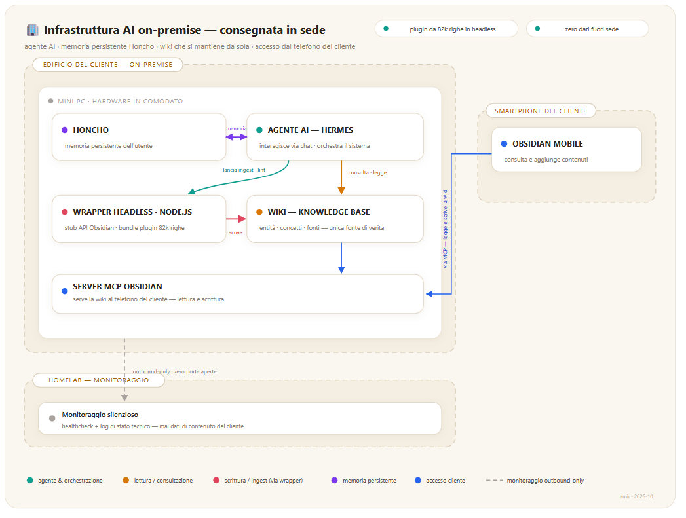
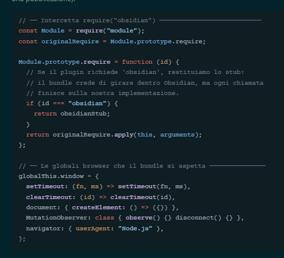

> **🌐 English version available: [README.md](README.md)**

---

# Come ho fatto girare un plugin Obsidian da 82.000 righe in headless, e l'ho consegnato a un'azienda in sede

Ho venduto a una piccola azienda locale un'infrastruttura AI on-premise: un agente che vive nel loro edificio, con i dati che non escono mai dalla sede. Il pezzo più difficile da progettare era la knowledge base, una wiki che si mantiene da sola, senza schermo e senza che il cliente ci metta mano.

Per farlo ho dovuto far girare in headless un plugin Obsidian. Quello normale vive dentro l'app desktop, con schermo, mouse e menu a tendina: qui doveva essere orchestrato da un agente AI.

La strada sembrava semplice. Riscrivere la logica in una skill Hermes e via. Poi ho aperto il bundle del plugin e ho trovato 3.6MB di codice compilato, 82.009 righe. Anni di sviluppo e decine di feature: dedup, alias, schema enforcement, lint automatico, analisi LLM.

Riscriverle avrebbe significato settimane di lavoro, con il rischio di produrre qualcosa di divergente che si sarebbe rotto al primo aggiornamento.

Ho fatto un'altra cosa. Ho costruito uno stub dell'API Obsidian in Node.js, ho convinto il plugin di essere su un desktop e l'ho fatto girare headless su un server remoto.

Il risultato: zero crash su 82.000 righe, 16 bug risolti, 68 test superati su 68 e una wiki che si mantiene da sola.



> *Diagramma: l'edificio del cliente con il mini PC in comodato (agente AI, memoria Honcho, wrapper headless, wiki, server MCP), il telefono del cliente collegato via MCP, e il solo flusso in uscita verso la mia omelab per il monitoraggio. Nessun dato di contenuto esce dalla sede.*



> *Il cuore del wrapper: `Module.prototype.require` viene intercettato, così ogni richiesta di `obsidian` dal bundle da 82.000 righe riceve il nostro stub, insieme alle globali browser fittizie (`window`, `setTimeout`, `MutationObserver`) che il plugin si aspetta.*

---

## Fallimento 1 di 5: TypeError a raffica

Primo avvio del wrapper: `node index.js ingest file.md`. Risposta:

```
TypeError: Cannot read properties of undefined (reading 'getSecret')
TypeError: plugin.addRibbonIcon is not a function
TypeError: plugin.addStatusBarItem is not a function
TypeError: this.registerView is not a function
TypeError: app.vault.getMarkdownFiles(...).filter is not a function
```

Sei errori in fila. Il plugin si aspettava un ambiente Obsidian completo, con API di sicurezza, UI, workspace e vault, e trovava `undefined` dappertutto.

Il problema di fondo è che il plugin Karpathy LLM Wiki (v1.26.0) chiama 39 metodi dell'API Obsidian, sparsi su quattro oggetti principali (App, Plugin, Vault, Notice). Alcuni sono ovvi, come leggere e scrivere file. Altri sorprendono: `secretStorage.getSecret()` per le API key, `addRibbonIcon()` per la UI, `registerView()` per la finestra di query.

Ogni metodo che manca è un TypeError, e ogni TypeError è un crash.

### La soluzione: uno stub tracciante

Invece di indovinare quali API servissero, ho messo un Proxy JavaScript che intercetta ogni accesso a una proprietà non definita, lo logga e restituisce un valore di default. Con lo stub tracciante ho lanciato il plugin e in cinque minuti sapevo esattamente quali fossero le 39 chiamate necessarie.

```
Fase 1 — Scoperta API (5 minuti):
  App:         secretStorage.getSecret, secretStorage.setSecret, workspace, vault
  Plugin:      loadData, saveData, registerView, addCommand, addRibbonIcon, addStatusBarItem
  Vault:       read, create, modify, delete, getMarkdownFiles, getAbstractFileByPath, process, cachedRead, getRoot
  Notice:      Notice(), hide(), setMessage()
```

Senza il Proxy avrei passato ore a leggere la documentazione del plugin o a tirare a indovinare.

---

## Ostacolo 1 di 5: Obsidian non esiste su un server

Con le API mappate restava da implementarle davvero. Alcune sono banali da simulare, tanto che `addRibbonIcon()` può semplicemente restituire un oggetto vuoto. Altre devono funzionare per davvero sul filesystem.

### Vault, il blocco più grosso

Il plugin legge e scrive file in continuazione: entità, concetti, fonti, index, log. Uno stub che risponde `{}` non basta, serve un'implementazione che sappia leggere i file `.md` dal disco, creare cartelle e file nuovi al posto giusto, aggiornare l'index quando cambia qualcosa e supportare lettura atomica più scrittura (`Vault.process()`).

Alla fine ho scritto 18 metodi del Vault che lavorano direttamente sul filesystem con il modulo `fs` di Node.js. Nessun database e nessuna cache, solo operazioni vere su file veri.

### Secret Storage, le API key

La v1.26.0 del plugin ha introdotto il Secret Storage di Obsidian (API v1.25+) per tenere al sicuro le chiavi Gemini. In headless non esiste, quindi ho messo uno stub che legge e scrive un file `.secrets.json` nella cartella del plugin. Le chiavi restano sul server.

### Window, le globali del browser

Il bundle si aspetta `window`, `document`, `setTimeout` e `MutationObserver`. In Node.js non ci sono, quindi ho costruito un ambiente browser fittizio:

```javascript
globalThis.window = {
  setTimeout: setTimeout.bind(globalThis),
  clearTimeout: clearTimeout.bind(globalThis),
  setInterval: setInterval.bind(globalThis),
  document: { createElement: () => ({}), addEventListener: () => {} },
  MutationObserver: class { observe() {} disconnect() {} },
  location: { href: '' },
  navigator: { userAgent: 'Node.js' },
  matchMedia: () => ({ matches: false })
};
```

Senza `setTimeout` il plugin andava in timeout su `startupCheck()`. Un `await new Promise(r => setTimeout(r, 3000))` che non si risolveva mai.

---

## Fallimento 2 di 5: il ReferenceError che mi ha fatto impazzire

Dopo aver sistemato lo stub ho ritentato l'ingest:

```
TypeError: (0 , import_obsidian.requestUrl) is not a function
```

Il plugin usa `requestUrl()` di Obsidian per tutte le chiamate HTTP verso l'API Gemini, e in headless `obsidian.requestUrl` non esiste. L'ho implementata con il `fetch` nativo di Node.js.

Prima chiamata: funziona. Seconda chiamata:

```
TypeError: Body is unusable: Body has already been read
```

Il plugin leggeva `response.text()`, poi `response.json()`, poi `response.arrayBuffer()`: tre letture dello stesso stream HTTP. In Node.js un body `fetch` si consuma una volta sola.

Ho risolto leggendo una sola volta `response.text()` e ricavando `json` e `arrayBuffer` dalla stringa. Al plugin non serve lo stream originale, gli servono i dati.

È il tipo di bug che in sviluppo non emerge mai, perché Obsidian ha il suo layer HTTP, e che in headless esplode subito.

---

## Decisione progettuale: perché uno stub e non una riscrittura

Ci ho pensato diverse volte a riscrivere tutto in uno script Python. Ho scartato l'idea per tre motivi:

| Approccio | Vantaggi | Svantaggi |
|-----------|----------|-----------|
| **Riscrittura** | Controllo totale, nessuna dipendenza | Settimane di lavoro, comportamento divergente, si rompe a ogni update |
| **Stub + Plugin** | Stessa logica, stesso comportamento, aggiornamenti automatici | Complessità dello stub, 3.6MB caricati a ogni chiamata |

Il plugin ha feature che sarebbe stato folle replicare: merge dei duplicati con analisi semantica LLM, alias matching per i wikilink interrotti, schema enforcement con template configurabili, retag automatico contro un vocabolario validato, smart fix che sistema decine di problemi in un solo run.

Riscrivere tutto sarebbe stato un secondo progetto, non un wrapper.

I numeri hanno confermato la scelta dello stub: 68 test superati su 68, 16 bug risolti in 6 iterazioni, due giorni di sviluppo totale.

Per dare l'idea della complessità, solo l'oggetto `Vault` ha 18 metodi implementati (`read`, `create`, `modify`, `delete`, `getMarkdownFiles`, `getAbstractFileByPath`, `process`, `cachedRead`, `getRoot`, `trashFile`, `append`, `exists`, `getFileByPath`, `getFolderByPath`, `createFolder`, `readBinary`, `writeBinary`, `getAllLoadedFiles`), ognuno con error handling, logging e permessi. Lo stub intero, sommando Vault, App, Plugin, Notice e Workspace, supera le 600 righe. Non è poco codice, ma è niente rispetto alle 82.000 righe che permette di eseguire.

---

## Fallimento 3 di 5: lo smart fix che non finiva mai

Il lint del plugin si comporta in modo subdolo. `lintWiki()` è una funzione `async` che si risolve subito dopo lo scan iniziale, mentre lo smart fix continua in background tra Promise e Notice. Hermes leggeva quindi il report parziale, quello pre-fix, e rispondeva all'utente con dati incompleti.

### Problema

```
1. Lint parte → scan iniziale (3 secondi)
2. lintWiki() si risolve → Hermes legge il report parziale
3. [IN BACKGROUND] Smart fix continua per 300 secondi
4. Hermes ha già risposto all'utente con dati sbagliati
```

### La soluzione: fs.watch su log.md

Il plugin scrive il report in `log.md` due volte. La prima dopo pochi secondi, con il risultato dello scan, la seconda tra i 10 e i 300 secondi con il report finale post-fix. Ho messo un `fs.watch` che conta le scritture: la prima viene ignorata, la seconda sblocca il worker, che legge il report finale e lo restituisce.

```javascript
const watcher = fs.watch(logPath, (eventType) => {
  if (eventType === 'change') {
    writeCount++;
    if (writeCount >= 2) {
      watcher.close();
      resolve(); // Sblocca il worker
    }
  }
});
```

Non c'è nessun timeout e nessun polling, e funziona anche su lint da 100 pagine e oltre che impiegano cinque minuti.

### Secondo problema: trashFile cancellava per davvero

Durante lo smart fix il plugin elimina le pagine duplicate chiamando `trashFile()`. Nel mio primo stub quel metodo finiva su `fs.unlinkSync()`, cioè cancellazione permanente senza cestino.

In Obsidian `trashFile()` sposta i file nel cestino di sistema, quindi ho implementato un cestino mio: `.trash/<path_con_timestamp>.trash`. Si recupera tutto, e prima di ogni lint la wiki viene salvata automaticamente.

### Terzo problema: i backup si accumulavano

Ogni lint lasciava un backup in `.hermes/tmp/wiki-backup-<ts>/`. Dopo dieci lint, dieci backup, e nessuno li puliva. Ho aggiunto un `fs.rmSync(backupDir, { recursive: true, force: true })` a lint finito, così non resta niente in giro.

---

## In produzione: dal mio VPS alla sede del cliente

Tutto quello che ho raccontato finora è successo sul mio VPS, nel mio laboratorio di validazione. Non mi interessava far funzionare un plugin in headless: mi interessava essere sicuro che lo stesso bundle reggesse dove non c'è nessuno dietro la console. Ed è esattamente il posto in cui l'ho consegnato: una piccola azienda locale, anonima su sua richiesta, che lo usa come layer di knowledge management della sua infrastruttura AI on-premise.

L'architettura che ho progettato e installato in sede:

| Componente | Cosa fa | Dove gira |
|-----------|---------|----------|
| **Agente AI** | Interlocutore del cliente via chat; mantiene la wiki con il wrapper headless descritto qui sopra | Mini PC in sede (hardware di mia proprietà, dato in comodato d'uso) |
| **Memoria persistente dell'utente** | Ricordo delle interazioni tra le sessioni, gestito da Honcho | Stesso mini PC |
| **Wiki — knowledge base generale** | Conoscenza del cliente: l'agente la mantiene (lint, merge, alias), il cliente la consulta e la arricchisce | Stesso mini PC |
| **Obsidian mobile via server MCP** | L'app sul telefono del cliente collegata al server MCP che serve la wiki | Smartphone del cliente |

Il nodo del progetto sono due consumatori su un'unica fonte di verità. L'agente scrive nella wiki con il plugin headless, lo stesso `main.js` byte per byte, mentre il cliente legge e aggiunge dal telefono. Nessuno dei due sa che l'altro esiste: si sincronizzano sul filesystem e non esistono versioni divergenti.

Tre cose che ho potuto garantire al cliente in fase di vendita, tutte possibili grazie allo stub:

- I contenuti della wiki non lasciano mai l'edificio. Verso la mia omelab viaggia solo lo stato tecnico del monitoraggio silenzioso, healthcheck e log minimi.
- L'accesso remoto si revoca con un click. La connessione è outbound-only su una rete mesh privata e sul router del cliente non resta aperta nessuna porta.
- La logica che mantiene la wiki è la stessa tra i miei dispositivi e il mini PC del cliente. Quello che ho validato qui gira anche là.

---

## Test come progressione: da 5/10 a 10/10

La validazione è stata fatta in 6 test progressivi su file reali, con una wiki da 54 entità, 58 concetti e 13 fonti. Ecco la progressione:

| Test | Versione | Durata | Gap | Voto |
|------|----------|:------:|:---:|:----:|
| T1 — Stub e caricamento | v0.1→v0.7 | 35 min | 7 | 10/10 |
| T2 — Ingest singolo | v1.0.0 | ~60s | 5 | 10/10 |
| T3 — Ingest folder/multi | v1.0.0 | ~300s | 1 | 10/10 |
| T4 — Lint e reindex | v1.0.0 | 4-120s | 1 | 10/10 |
| T5 — CLI rapida | v1.0.0 | <100ms | 0 | 10/10 |
| T6 — Produzione reale (126KB) | v1.2.0 | 123+308s | 3 | 10/10 |

Il voto non è mai sceso sotto 10/10 perché ogni gap l'ho risolto prima di passare al test successivo. I bug uscivano, li sistemavo, e il test dopo partiva già sulla versione corretta.

### Cosa ha fatto il wrapper in produzione (T6)

Ingest di un file reale da 126KB (788 righe):

| Operazione | Risultato |
|-----------|-----------|
| Rate limiter | Attivo: 16s tra richieste, 15 req/min |
| Pagine create | 1 source + 7 entities + concetti |
| Placeholder schema | 12 warning cosmetici (risolti) |
| Tempo totale | 123 secondi |

Lint in produzione, su più di 100 pagine:

| Categoria | Quantità | Dettaglio |
|:----------|:--------:|:----------|
| 🔧 Sources normalizzati | 9 file | gemini, hetzner, karpathy, node-js, syncthing, layer-meccanico, rate-limiter, stub, wrapper |
| 🔗 Wikilink corretti | 4 | claude-code, composio-mcp, gemini, hermes-agent |
| 📄 Stub creati | 2 | entities/gmail.md, concepts/automazione.md |
| 🏷️ Alias aggiunti | 6 entità | gmail +4, google-maps +5, google-sheets +6, automazione +6, mcp +1, skill-system +5 |
| 🔀 Merge duplicati | 1 | sources/avvia-un-business merged |

Tempo totale: 308 secondi. Exit code: 0.

Per contesto, lo stesso lint su Obsidian desktop impiega circa 180 secondi. I 128 secondi di differenza dipendono dal fatto che il wrapper carica il bundle da zero a ogni chiamata, 3.6MB da disco, mentre Obsidian lo tiene già in memoria. Un demone persistente ridurrebbe il divario a pochi secondi.

---

## Rischi residui

1. Aggiornamento del plugin: se il plugin Karpathy si aggiorna e chiama API nuove, lo stub va rivisto con una nuova fase di tracciamento. Senza, il wrapper si rompe in silenzio.

2. Cache di Node.js: il bundle da 3.6MB viene ricaricato a ogni chiamata. La cache V8 aiuta ma non elimina il costo. Con operazioni frequenti, tipo più query di fila, potrebbe servire un demone persistente.

3. API Obsidian non standard: alcune feature del plugin usano API non documentate. Se Obsidian le depreca, il plugin si rompe e lo stub con lui.

4. Nessuna UI: funziona tutto, ma non c'è feedback visivo. Niente barra di progresso né notifiche a schermo, l'output è solo testuale.

5. Supporto a distanza lato cliente: gli interventi passano dal monitoraggio silenzioso sulla mia omelab, healthcheck e log di stato tecnico. Finché i clienti restano sotto una soglia gestibile basta un unico punto umano. Oltre quella soglia servono altri livelli di assistenza, un'architettura che ho già pensato ma non ancora costruito.

---

## Lezioni e prossimi passi

Da questa storia esce una cosa sola: non serve riscrivere ciò che già funziona. A volte la soluzione più elegante è costruire un ambiente fittizio che convinca il software di essere a casa sua.

I pattern che mi porto dietro:

- Prima di implementare uno stub, lascia che sia il sistema a dirti cosa serve. Un Proxy che logga ogni accesso a una proprietà mancante è più veloce di qualsiasi analisi statica.
- Per sincronizzarsi con un processo asincrono, watchare il filesystem è più pulito che pollare ogni N secondi.
- Ogni operazione distruttiva, che sia un lint, un merge o un fix, dovrebbe fare un backup prima. Costa poco e salva la giornata.
- Il wrapper usa lo stesso `main.js` del plugin su laptop e iPhone, quindi lint e ingest danno risultati identici su qualsiasi dispositivo.

La lezione più grande è che un plugin Obsidian è solo codice JavaScript. Se riesci a ingannarlo sul suo ambiente di esecuzione, lo fai girare ovunque, che sia Docker, un server, una pipeline CI/CD o una edge function. Il confine tra app desktop e servizio remoto è molto più sottile di quanto sembri.

### Prossimi passi

- Un demone persistente che tenga il plugin caldo in memoria, per far scendere il caricamento da 3 secondi a circa 100 millisecondi
- Query LLM attraverso il wrapper, invece di navigare la wiki a mano
- La fase di tracciamento automatica quando il plugin si aggiorna

Il repository del wrapper è su GitHub. E per chi fa il mio lavoro: questo è uno dei layer che progetto e consegno alle PMI come infrastruttura AI on-premise. La parte tecnica resta quella, cambia solo l'ambiente in cui deve reggere da solo, senza nessuno dietro la console.

---

## Risorse

- [Repository GitHub](https://github.com/amirtabit31-byte/plugin-karpathy-wrapper-headless)
- Manuale di progettazione completo: `progettazioni/completate/plugin-wiki + hermes/`
- Skill `llm-wiki-karpathy`, interfaccia Hermes per il wrapper
